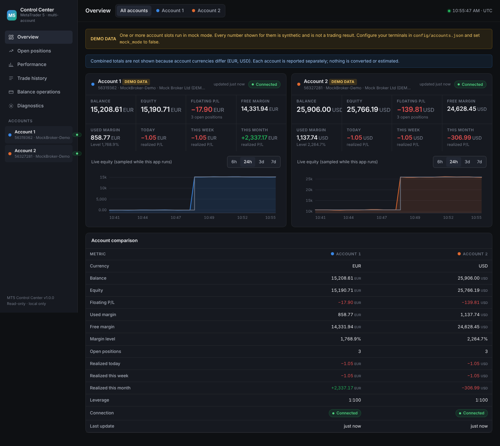
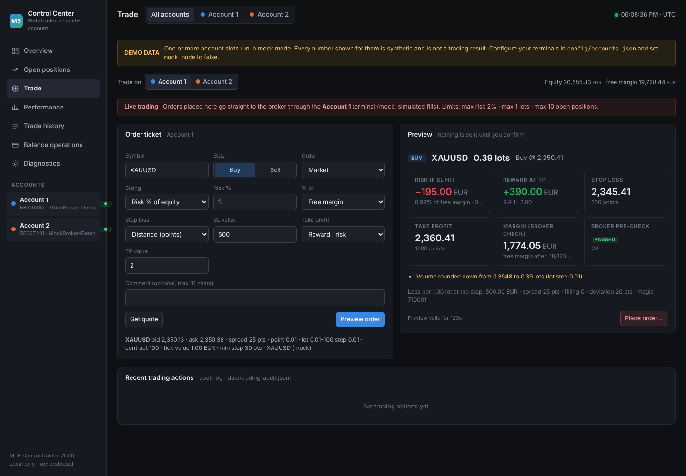

# MT5 Trading Control Center

A professional, dark-themed trading terminal for **monitoring two (or more)
MetaTrader 5 accounts at once** on your own Windows computer.

* Pure Python backend (FastAPI) + a hand-built HTML/CSS/JavaScript dashboard.
  **No Node.js, no npm, no build tools, no cloud.**
* Each MT5 account runs in its **own isolated Python worker process**, so data
  from one terminal can never leak into the other.
* **Monitoring is read-only; trading is opt-in.** Out of the box the
  application only reads account information, open positions and deal
  history. A separate trading module (close / partial close / modify SL-TP /
  place orders with risk-based sizing) must be switched on explicitly, per
  account, and every order goes through a preview and a typed confirmation.
  See [Trading](#6-trading-optional).
* **Local-only and key-protected** - see [Security](#7-security).





---

## 1. What you need

| Item | Notes |
|------|-------|
| Windows 10 / 11 | The official `MetaTrader5` Python package only exists for Windows. |
| Python 3.12 (or 3.11+) | From [python.org](https://www.python.org/downloads/windows/). During installation tick **"Add python.exe to PATH"**. |
| Two MetaTrader 5 installations | One terminal per account, each installed in its own folder (see step 3). |
| Internet access, once | Only to download the Python packages the first time you start. |

You do **not** need to know programming. Everything is driven by two small
settings files and a double-click launcher.

## 2. Install

1. Download this folder (`mt5-control-center`) to your PC, for example to
   `C:\Trading\mt5-control-center`. Avoid paths inside *Program Files*.
2. Double-click **`start.bat`**.
   The first start creates a private Python environment inside the folder
   (`.venv`), installs the dependencies and then starts the dashboard in demo
   mode so you can see what it looks like. Later starts take a few seconds.
3. The launcher window prints a line like
   `Open this link in your browser (it carries your private access key)` and
   opens your default browser automatically. Bookmark nothing yet - the link
   changes if you ever rotate the key.
4. Press **Ctrl+C** in the launcher window (or close it) to stop everything.

The first run also creates `config\settings.json` and `config\accounts.json`
from the example files. Those two files are the only things you edit.

## 3. Connect your real MT5 accounts

### 3.1 Prepare two terminals

The `MetaTrader5` Python bridge can hold **one terminal per process**. This
application starts one worker process per account, but each worker still needs
its own terminal installation:

* Install MetaTrader 5 a second time into a **different folder**
  (e.g. `C:\MT5-Broker-A\` and `C:\MT5-Broker-B\`), or copy an existing
  installation folder and run the copy with the `/portable` switch.
* Start each terminal once by hand, log into the account it should serve, and
  in **Tools → Options → Expert Advisors** tick **"Allow algorithmic trading"**
  (the Python bridge needs it even though this program never trades).
* Note the full path of each `terminal64.exe`.

### 3.2 Edit `config\accounts.json`

Open the file in Notepad. It contains one block per account:

```json
{
  "accounts": [
    {
      "id": "account1",
      "label": "Broker A - Main",
      "color": "blue",
      "terminal_path": "C:\\MT5-Broker-A\\terminal64.exe",
      "portable": false,
      "login": 12345678,
      "server": "BrokerA-Live",
      "password_env": "MT5CC_ACCOUNT1_PASSWORD",
      "server_utc_offset_hours": 2,
      "enabled": true
    },
    {
      "id": "account2",
      "label": "Broker B - Swing",
      "color": "orange",
      "terminal_path": "C:\\MT5-Broker-B\\terminal64.exe",
      "portable": true,
      "login": 87654321,
      "server": "BrokerB-Real",
      "password_env": "MT5CC_ACCOUNT2_PASSWORD",
      "server_utc_offset_hours": 3,
      "enabled": true
    }
  ]
}
```

| Field | Meaning |
|-------|---------|
| `id` | Short internal name (letters, digits, `-`, `_`). Used in URLs and exports. |
| `label` | What the dashboard shows. |
| `color` | `blue`, `orange`, `aqua`, `yellow`, `magenta` or `violet`. |
| `terminal_path` | Full path to that account's `terminal64.exe`. Use double backslashes `\\` inside JSON. |
| `portable` | `true` if that terminal is run with `/portable` (data folder next to the exe). |
| `login`, `server` | Account number and trade server name exactly as shown in the terminal. |
| `password_env` | Name of a Windows environment variable holding the **investor (read-only) or master password**. Recommended. See 3.3. |
| `password` | Alternative to `password_env`: the password written directly in this file. Works, but anyone who can read the file can read it. |
| `server_utc_offset_hours` | Your broker's server clock offset from UTC (often `2` or `3`). Used to place trades in the right day and trading session. |
| `enabled` | Set to `false` to skip a slot without deleting it. |

**Attach mode (no password at all).** If you leave `login`, `server` and both
password fields empty, the worker simply attaches to whatever account that
terminal is already logged into. If you *do* set `login`, the worker verifies
the terminal is logged into exactly that account and refuses to show data
otherwise - this is the safeguard against mixing accounts.

**Use the investor password** whenever you can. It grants read-only access,
which is all this application ever needs.

### 3.3 Store passwords as environment variables (recommended)

In PowerShell (run once, per account, replacing the values):

```powershell
[Environment]::SetEnvironmentVariable("MT5CC_ACCOUNT1_PASSWORD", "your-investor-password", "User")
[Environment]::SetEnvironmentVariable("MT5CC_ACCOUNT2_PASSWORD", "your-other-password", "User")
```

Close and reopen the launcher afterwards so it sees the new variables. The
Diagnostics page shows whether each variable was found (never its value).

### 3.4 Turn demo mode off

In `config\settings.json` change `"mock_mode": true` to `"mock_mode": false`.
Start the launcher again. The yellow **DEMO DATA** banner disappears once no
slot is synthetic.

## 4. `config\settings.json`

```json
{
  "server": { "host": "127.0.0.1", "port": 8731, "open_browser": true },
  "refresh_seconds": 2,
  "history_refresh_seconds": 15,
  "history_lookback_days": 365,
  "equity_sample_seconds": 30,
  "report_timezone": "local",
  "mock_mode": true,
  "log_level": "INFO"
}
```

| Setting | Meaning |
|---------|---------|
| `server.host` / `server.port` | Where the local web server listens. Keep the loopback address so only this computer can reach it. Change the port if another program already uses it. |
| `server.open_browser` | Open the dashboard automatically on start. |
| `refresh_seconds` | How often account/position snapshots are pulled from each terminal. |
| `history_refresh_seconds` | How often new deals are pulled (also immediately when positions change). |
| `history_lookback_days` | How far back deal history is loaded at start. |
| `equity_sample_seconds` | How often live equity is written to the local database for the equity chart. |
| `report_timezone` | `local`, `UTC`, or an IANA name such as `Europe/Nicosia`. Day/week/month periods use it. |
| `mock_mode` | `true` forces synthetic demo data for every slot (also `MT5CC_MOCK=1`). |
| `trading_enabled` | Global trading switch, `false` by default. See section 6. |

## 5. What the dashboard shows

* **Overview** - per-account balance, equity, floating P/L, free/used margin,
  margin level, open positions, currency, connection state and last update;
  realized P/L today / this week / this month; a live equity chart sampled
  while the app runs; a side-by-side comparison table. Combined totals appear
  **only** when all accounts share one currency - nothing is converted.
* **Open positions** - every open position with swap, profit and net.
* **Performance** - per period (today, week, month, year, all loaded, custom
  range): realized P/L (deal-based, same method as the MT5 report), closed
  trades, wins/losses, win rate, average win/loss, profit factor, expectancy,
  volume, max drawdown; cumulative realized curve, drawdown curve, daily P/L
  bars, balance history; breakdown by symbol and by trading session; a clear
  split between gross result, commission, swap, fees, floating P/L, deposits,
  withdrawals and adjustments; and a **reconciliation** block that proves the
  reconstructed trades add up to the raw MT5 deal ledger.
* **Trade history** - closed trades with entry/exit time and price, volume,
  gross, commission, swap, fee, net, hold time and flags for partial closes,
  multiple entries, reversals and incomplete records. Filter by account,
  symbol, result, side and date; **Export CSV** of the filtered set.
* **Balance operations** - deposits, withdrawals, credit and adjustments,
  listed separately and never counted as trading profit.
* **Diagnostics** - worker process health, terminal build/ping, connection
  mode, password source (name only), restarts, heartbeat age, history window,
  reconciliation status, worker log, plus **Reconnect** and **Reload history**
  buttons.

### How numbers are calculated (and what is *not* guessed)

* **Realized P/L** for a period = profit + commission + swap + fee of every
  BUY/SELL deal closed in that period. Identical to the terminal's own report.
* **Trades** are rebuilt per position from the deal ledger. Every closing deal
  becomes one trade row carrying the volume-weighted entry price and its share
  of entry commissions. Partial closes therefore appear as several rows;
  in/out reversals are split into the closed part and the new position.
* If a closing deal's entry is not in the terminal's history, the worker tries
  to fetch that position's deals directly. If they still cannot be found the
  trade is marked **incomplete** (entry price shown as "unknown") instead of
  being estimated.
* **Verified vs MT5 deals** means: Σ trade net + unallocated entry costs of
  open positions = Σ deal ledger net, within 0.01. If it does not hold, the
  Performance page says so and shows the difference.
* **Drawdown** is measured on cumulative closed-trade results only - deposits,
  withdrawals and floating P/L are excluded.
* **Trading sessions** are classified by entry time in UTC after applying the
  per-account server clock offset: Asia 00-08, London 08-13, overlap 13-17,
  New York 17-22, late 22-24.
* The **equity chart** only contains values actually observed while the app was
  running. There is no back-filled "historical equity".

## 6. Trading (optional)

Trading is **off by default** and stays off until *both* switches are on:

1. `config\settings.json` → `"trading_enabled": true` (global kill switch)
2. `config\accounts.json` → inside the account block,
   `"trading": { "enabled": true, ... }`

Trading also needs the **master password** (or a terminal already logged in
with it). With an investor password the broker reports "trade not allowed" and
the application refuses to send anything. The Diagnostics page shows, per
account, whether trading is possible and if not, why.

### Per-account limits

```json
"trading": {
  "enabled": true,
  "max_risk_percent": 1.0,
  "max_lots": 1.0,
  "max_open_positions": 10,
  "allowed_symbols": [],
  "magic": 710001,
  "deviation_points": 20
}
```

| Field | Meaning |
|-------|---------|
| `max_risk_percent` | Hard cap on the loss-at-stop of any single order, as % of equity. Orders above it are refused before reaching the broker. |
| `max_lots` | Hard cap on volume per order. |
| `max_open_positions` | No new orders when the account already has this many positions. |
| `allowed_symbols` | Empty = any symbol. Otherwise only these (e.g. `["EURUSD", "XAUUSD"]`). |
| `magic` | Identifier stamped on every order from this app, so you can tell them apart in the terminal. |
| `deviation_points` | Maximum slippage accepted for market orders. |

### Placing an order (the **Trade** page)

1. Pick the account, type the symbol, choose Buy/Sell and Market / Limit / Stop.
2. Choose sizing:
   * **Risk %** of **free margin**, **equity** or **balance** (your choice in
     the "% of" box) - e.g. `1` of free margin means *"lose at most 1% of the
     current free margin if the stop is hit"*. The volume is calculated from
     the stop distance and the symbol's tick value, then **rounded down** to
     the lot step so the real risk is never above what you asked. This mode
     requires a stop-loss. `max_risk_percent` is enforced against the chosen
     basis *and* against equity, so a large free margin from credit or bonus
     cannot push the loss past the cap.
   * **Fixed lots** - you type the volume.
3. Stop-loss as a distance in points or a price; take-profit as reward:risk
   (e.g. `2`), points, or price.
4. **Preview order** shows the exact volume, entry, stop, target, money at
   risk, reward, broker margin check and any warnings. Nothing is sent yet.
5. **Place order…** opens a confirmation where you type `BUY` or `SELL`.
   Only then is the order sent, and only if the market has not changed the
   computed volume since the preview (previews expire after two minutes).

### Managing positions (the **Open positions** page)

Each position of a trading-enabled account has **SL/TP**, **Partial** and
**Close** buttons. Close and partial close send a market order for the
opposite side against that position ticket; each asks for confirmation.

### What protects you

* Both switches, the broker's own "trade allowed" flag and the terminal's
  "algorithmic trading" setting are re-checked inside the worker before every
  single order.
* The worker refuses to trade if the terminal is logged into a different
  account than configured.
* Every order is validated locally (limits, stop side, broker minimum stop
  distance, lot step) and then with the broker's `order_check` before
  `order_send`.
* The confirmation carries a signed copy of the previewed request; a changed
  or replayed request is refused.
* Every action (sent / rejected / result) is appended to
  `data\trading-audit.jsonl` and shown on the Trade page.
* Pending orders (limit/stop) are placed but not otherwise managed by this
  application; cancel them in the terminal.

Trading involves risk. The application enforces the limits you configure, but
it does not judge whether a trade is a good idea.

## 7. Security

Threat model: something else on your PC (or a web page you visit) trying to
read your trading data from the local server, and the usual mistakes of
local dashboards.

* **Loopback only.** The server binds to the local address from
  `settings.json`; other computers on your network cannot reach it.
* **Private access key.** A random key is generated on first start
  (`config\.api_token`). Every API request must present it - the launcher link
  hands it to your browser once, after which it lives in an `HttpOnly`,
  `SameSite=Strict` cookie. Delete the file to rotate the key.
* **Cross-site and DNS-rebinding protection.** Requests whose `Host` header is
  not the configured address are refused; browser requests from other origins
  are blocked.
* **Strict Content-Security-Policy.** Only same-origin scripts and styles are
  allowed; the dashboard loads **nothing from the internet** (no CDN fonts,
  no analytics, no chart libraries).
* **No secrets leave the process.** Passwords are read inside the worker
  subprocess only; the API never returns them, and logs never print them.
* **Read-only unless you opt in.** With trading off (the default) there is no
  code path that sends trade requests; the only "write" actions are
  *Reconnect* and *Reload history*. With trading on, see section 6.
* **No remote API docs.** The automatic FastAPI documentation pages are
  disabled.
* **Dependencies**: `fastapi`, `uvicorn`, `MetaTrader5`. Nothing else.

Things you should still do: keep `config\accounts.json` and `config\.api_token`
out of cloud-synced folders, prefer the investor password, and keep Windows and
Python updated.

## 8. Troubleshooting

| Symptom | What to check |
|---------|---------------|
| `initialize() failed` in Diagnostics | Wrong `terminal_path`; terminal not allowed to run algorithmic trading; wrong `portable` flag; the terminal is already being driven by another Python process. |
| `Terminal is logged into account X, but this slot is configured for Y` | The terminal in that folder is logged into a different account. Log into the right one or fix `login`. |
| Password variable shown as *(not set)* | Set it with the PowerShell command in 3.3, then restart the launcher. |
| Realized today looks wrong by a few hours | Adjust `server_utc_offset_hours` for that broker and/or `report_timezone`. |
| "Unverified · diff …" badge | The deal ledger and reconstructed trades disagree. Usually old positions whose entries predate `history_lookback_days`; press **Reload history** or raise the lookback. Please report persistent cases. |
| Port already in use | Change `server.port` in `settings.json`. |
| Dashboard says *Dashboard locked* | Open it via the launcher link, or paste the key from `config\.api_token`. |
| Trade page says trading is off | Both `trading_enabled` (settings) and `trading.enabled` (account) must be true, the account must use the master password, and the terminal must allow algorithmic trading. The page lists exactly which condition fails. |
| Order refused: "exceeds max_lots / max_risk_percent" | Raise the limit in `accounts.json` or widen the stop / lower the risk. The refusal happens before anything reaches the broker. |

Logs are in `logs\control-center.log`.

## 9. Project layout

```
mt5-control-center/
├─ start.bat                  double-click launcher (creates .venv, installs, runs)
├─ Start-ControlCenter.ps1    the same for PowerShell
├─ run-tests.bat              runs the self-tests
├─ requirements.txt
├─ config/
│   ├─ settings.example.json  copied to settings.json on first run
│   └─ accounts.example.json  copied to accounts.json on first run
├─ mt5cc/                     the application
│   ├─ __main__.py            entry point (python -m mt5cc)
│   ├─ config.py              settings/accounts loading, access key
│   ├─ security.py            token, host and cross-site checks, headers
│   ├─ supervisor.py          starts/watches one worker process per account
│   ├─ worker.py              the per-account subprocess (owns the MT5 link)
│   ├─ mt5_adapter.py         thin wrapper over the MetaTrader5 package
│   ├─ mock_adapter.py        synthetic demo data source
│   ├─ trading.py             position sizing, order/close/modify requests, guards
│   ├─ history.py             deal → trade reconstruction + reconciliation
│   ├─ stats.py               realized P/L, statistics, curves, sessions
│   ├─ store.py               SQLite store for live equity samples
│   ├─ server.py              the JSON API
│   └─ static/                dashboard (index.html, app.css, app.js, charts.js)
└─ tests/                     pytest suite (reconstruction, stats, API security)
```

## 10. Running the self-tests

Double-click `run-tests.bat` (or `.venv\Scripts\python -m pytest tests`). The
tests cover round trips, partial closes with cost allocation, reversals,
incomplete records, deposit separation, period statistics, the demo data's
own reconciliation, position sizing and order validation, the preview /
confirm protocol, and every security rule of the API.
